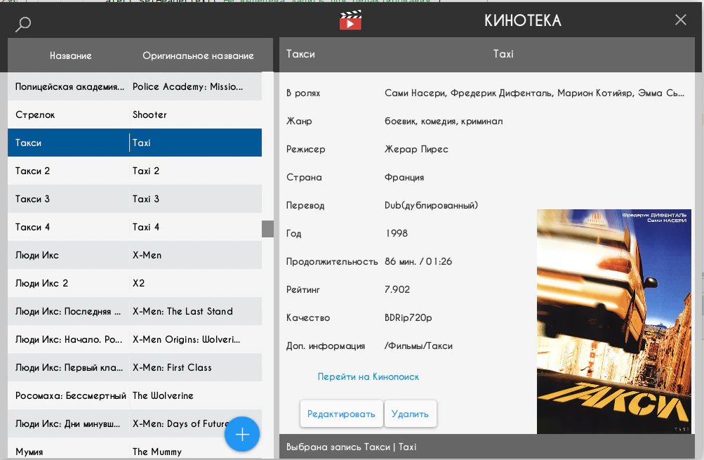
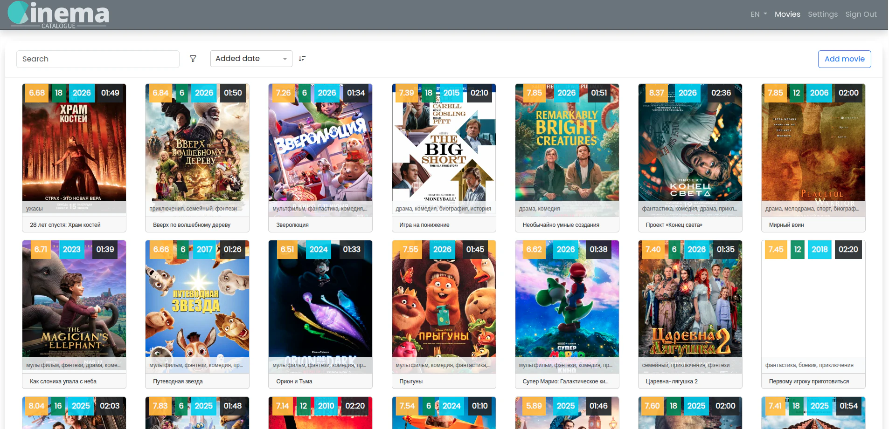
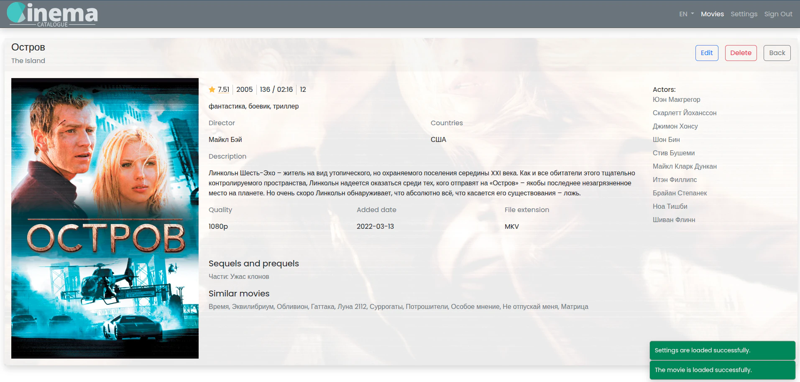

# MediaShelf


**Version 4.0.0** — a personal library for films, TV series and the titles you want to watch next.

MediaShelf began as a small way to keep track of my films. Four generations later, it is a responsive web app with a combined gallery, dedicated collection pages and mobile installation. The frontend is hosted on Firebase.

A personal, non-commercial project by **Aleksy Zwierzyński, Senior Frontend Engineer**. This repository is private-package metadata (`private: true`, `UNLICENSED`); it does not grant a license for redistribution or commercial use.

[Frontend repository](https://github.com/Zwezh/media-shelf) · [Backend repository](https://github.com/Zwezh/cinema-catalogue-be)

## What you can do

- Browse a combined gallery or separate Movies, Series and Wishlist pages.
- Find titles with global search, sorting, pagination and filters for genres, years, rating, quality, age certification and people.
- Add, edit and delete entries through protected workflows; inspect details, release formats and related films.
- Autofill metadata and artwork through Poiskkino. Requests run on the backend, keeping the provider token out of the browser.
- Track series production status, season availability, announced season counts and formats; filter by production status or missing seasons.
- Import and refresh wishlist entries, then move them into the library.
- Scan the library to save statistics by genre, quality, release year and rating.
- Switch between English, Russian and Polish, with language-aware title names; choose light, dark or system themes and shared quality, extension and genre settings.
- Install the app on mobile devices, open it without browser chrome and receive update prompts. The app shell works offline; library data and changes need a connection.

The public **About** page at `/about` tells the project’s story in all three languages and includes dependency information and installation instructions.

## Four generations

### 1. A first library, one window · 2010–2011

I wrote the first version while studying at Baranovichi State University. It was a C# desktop application built with Windows Forms, usually called WinForms: one window, a table of films and information entered by hand. I could add rows, edit entries and delete films. I no longer remember every detail, but this small tool was the beginning of the project.

Windows Forms was already the framework’s name at the time; Microsoft’s [2002 Visual Studio .NET launch transcript](https://news.microsoft.com/speeches/speech-transcript-anders-hejlsberg-visual-studio-net-launch/) documents its use. The original application code is not preserved here.

### 2. My Library Cinema · 2015–2016

I rebuilt the idea with Java 8 and JavaFX. **My Library Cinema**, or «Моя кинотека» in Russian, ran on different desktop operating systems and stored each installation’s collection in an XML file.

A sortable film list occupied the left panel; the right panel showed details or a workspace for adding and editing films. Search helped with larger collections, while an HTML scraper retrieved information and artwork from Kinopoisk. There was no mobile version or shared collection between devices.



### 3. Cinema Catalogue goes online

The third generation moved the library to the web with Angular and Node.js. Early versions were rough around the edges, but the project grew into [Cinema Catalogue](https://cinema-catalogue.web.app).

Angular 17, ng-bootstrap 16, Bootstrap and Font Awesome powered the interface, with ngx-translate for Russian, English and Polish. NestJS 10 and MongoDB powered the backend. Firebase hosted the frontend and Render hosted the backend; GitHub Actions checked lint and handled deployment after merges to the main branch.

This edition introduced a film gallery, search, filters, detail pages, quality and file-extension defaults, and Poiskkino API autofill.





### 4. MediaShelf · the current generation

I built MediaShelf entirely with AI coding agents in Codex—mostly GPT-6 and GPT-6.1 with medium reasoning—while personally guiding the work, reviewing changes and checking the result. The Lode method keeps decisions and project knowledge close to the code; Google Stitch helped shape the design.

The interface now uses Angular 22, signals, Signal Forms, NgRx SignalStore and ngx-translate, with a small set of focused dependencies. The backend grew from the previous edition, was updated to NestJS 12 and moved from MongoDB to SQLite/libSQL. Films, series and a wishlist now share one library, with the features described above.

## Main dependencies

### Frontend

| Dependency                | Purpose                                                       |
| ------------------------- | ------------------------------------------------------------- |
| Angular 22                | Standalone components, lazy routing, signals and Signal Forms |
| NgRx Signals 22           | Feature state and workflows through SignalStore               |
| ngx-translate 18          | Runtime English, Russian and Polish translations              |
| RxJS 7.8                  | HTTP streams, cancellation and asynchronous workflows         |
| Angular Service Worker 22 | App-shell caching and update notifications                    |
| SCSS and Nunito Sans      | Shared design tokens, component styles and typography         |

See [package.json](package.json) for exact dependency ranges. Development tooling includes TypeScript 6, Vitest 4, ESLint and Prettier.

### Backend

The [separate backend repository](https://github.com/Zwezh/cinema-catalogue-be) uses NestJS 12 on Node.js, SQLite/libSQL for SQL storage, and Passport, JWT and bcrypt for authentication and protected writes. Provider integration and saved statistics also live in the backend.

## Local development

Use Node.js **22.22.3** and npm **11.4.1**, matching CI. Other supported Node versions are listed in [package.json](package.json).

From this repository’s root:

```bash
npm ci
npm start
```

Open `http://localhost:4200/`. Angular reloads the app when source files change.

Run the backend separately using its repository’s setup instructions. The development proxy forwards `/api` to `http://localhost:3000`; production calls `https://cinema-catalogue-be.onrender.com/api` directly. The backend must allow the frontend origin through CORS.

### Metadata autofill

Editors request normalized metadata from authenticated `GET /api/kinopoisk/titles/:id/autofill`. Configure `KINOPOISK_API_TOKEN` in the backend’s ignored `.env` or deployment environment. Frontend configuration contains no provider credentials. See the [title autofill contract](lode/gallery/title-autofill.md).

## Quality checks and build

```bash
npm run check
npm run build
```

`check` runs ESLint and the non-watching unit suite. `npm test` starts the Vitest-backed Angular runner in watch mode; `npm run format:check` checks source formatting. GitHub Actions runs checks and a production build.

Production artifacts are written to `dist/app/browser`.

## Firebase deployment and merge protection

`.firebaserc` selects project `zwezh-media-shelf`; `firebase.json` targets its Hosting site `media-shelf` and serves `dist/app/browser` with application-route fallbacks and cache revalidation for PWA updates. Missing assets and `/api` requests return 404 rather than the app shell. Add new root application routes to the rewrite pattern when needed.

GitHub Actions checks PRs targeting `master` and pushes to `master`. A successful push run deploys its verified build to the Firebase Hosting live channel, including pushes created by merging a PR. PRs and manual CI runs perform validation only. New PR runs cancel older PR runs; master runs are serialized without interrupting active deployments.

One-time account setup:

1. In the Firebase console, select project `zwezh-media-shelf` and ensure its Hosting site `media-shelf` exists.
2. In [Google Cloud service accounts](https://console.cloud.google.com/iam-admin/serviceaccounts?project=zwezh-media-shelf), create a dedicated deployment account with **Firebase Hosting Admin** and **API Keys Viewer** roles. Download a JSON key and store its entire contents in the GitHub repository's **Settings → Secrets and variables → Actions → New repository secret**, named `FIREBASE_SERVICE_ACCOUNT_ZWEZH_MEDIA_SHELF`. Keep the key out of source control. These roles cover static live Hosting; no Firebase Auth or Cloud Run integration is configured. See Firebase's [service-account instructions](https://github.com/FirebaseExtended/action-hosting-deploy/blob/main/docs/service-account.md).
3. Ensure backend CORS permits `https://media-shelf.web.app` and `https://media-shelf.firebaseapp.com`, plus any custom frontend domain.
4. Commit and push these configuration files; after checks and deployment pass, verify [the live site](https://media-shelf.web.app), direct navigation to `/about` and gallery detail routes, login and API calls, and mobile installation.
5. In GitHub **Settings → Branches → Add branch protection rule**, target `master`. Enable **Require status checks to pass before merging**, select **Lint, test, and build**, and enable **Require branches to be up to date before merging**. Enable **Do not allow bypassing the above settings** to apply the gate to administrators too. If the check is not offered yet, run CI on a PR first. See [GitHub branch protection](https://docs.github.com/en/repositories/configuring-branches-and-merges-in-your-repository/managing-protected-branches/about-protected-branches).

The required check blocks PR merges while lint, tests or the build are pending or failing. Do not require **Deploy to Firebase Hosting** as a PR check: it runs after a push to `master`, so its result cannot gate the merge that triggers it. Enabling **Require a pull request before merging** additionally prevents normal direct pushes; use that option if you want every change to go through a PR. GitHub plan eligibility applies to protection on private repositories.

The Firebase web SDK configuration identifies browser services; it does not authorize CI deployment and is not needed for static Hosting. Only the project ID and deployment service-account secret are used here.

Code follows strict TypeScript, standalone OnPush components, signals, native template control flow and feature-owned state. Shared SCSS design tokens keep styling consistent. Accessibility work targets WCAG AA and AXE checks.

## Mobile installation and offline use

Host a production build over HTTPS. On the **About** page, choose **Install app** when offered, or open **How to install** for platform-specific instructions. On iOS, installation uses Safari’s Share menu and **Add to Home Screen**; on Android, use the browser’s installation prompt or menu. Installed apps open in their own window and include home-screen shortcuts.

After an online visit, the production service worker caches the app shell, pages, fonts and translations. Historical screenshots are cached when viewed. API responses, authentication and mutations are not cached; there is no offline editing queue. Development mode does not register the worker.

When an update is ready, the app offers a manual reload and reminds you to save your work first.

Hosting must provide an `index.html` fallback for application routes while handling API and asset requests separately. Avoid immutable caching for `index.html`, the web manifest and service-worker metadata. See the [PWA contract](lode/ui/pwa.md) for hosting and mobile verification details.

## Project documentation

The [About page](src/app/features/about/pages/about.html) presents the project history and features in English, Russian and Polish. The [Lode map](lode/lode-map.md) links the architecture, contracts and implementation notes used during development.
