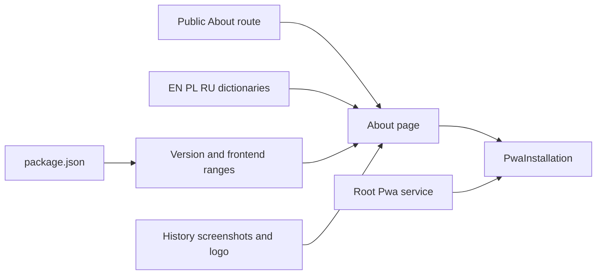

# About MediaShelf

`/about` is a public lazy page. Root navigation puts About after Settings; the translated route title and focused h1 work without an API request or authentication. `APP_VERSION` derives from package.json (4.0.0); package-lock root metadata stays aligned.

## Content and ownership

- Four history chapters describe the author's student C#/Windows Forms app (2010–2011), Java 8/JavaFX My Library Cinema (2015–2016), Angular 17/NestJS 10 Cinema Catalogue, and current Angular 22/NestJS 12 MediaShelf.
- Earlier history, dates and AI development details come from the author's account. Microsoft documentation confirms Windows Forms was the framework name in that era; it cannot establish which framework the original unpreserved code used.
- The author is Aleksy Zwierzyński. The current Firebase hosting sentence intentionally uses present tense per the author's content request; editing this page does not perform or verify a deployment.
- `README.md` mirrors the About page’s history, current features, main dependencies and screenshots, alongside developer setup, checks and PWA hosting guidance.
- A public section near the top explains backend loading after inactivity using `about.loadingTitle` and shared `common.coldStart` translations. Render's free-plan server sleeps while idle; the first request may take about 30–60 seconds or longer to wake it. About requires no backend request to show this explanation. README documents the same behavior and links to Render's hosting limits.
- English, Polish and Russian `about.*` dictionaries hold prose, features, captions and dependency descriptions. `about-content.ts` holds only shared structure, URLs and image metadata.
- Frontend dependency ranges derive from package.json. Backend names/major versions reflect the active sibling backend source; they are descriptive content, not a cross-project build import.
- Feature descriptions reflect Gallery/Movies/Series/Wishlist, global search, filters, protected workflows, provider autofill, season formats/availability, atomic Wishlist transfer, saved statistics, themes, localized title display and PWA limits.
- The three supplied screenshots use high-quality WebP (quality 90, sharp YUV conversion) under `public/images/about`, preserving their original dimensions. The repeated legacy detail screenshot is represented once. Native links open the full-resolution WebP images; NgOptimizedImage reserves their aspect ratio with lazy loading. README uses the same assets. Unused PNG copies are removed.
- Historical screenshots use a lazy worker asset group. The shell and translations are prefetched; API data remains network only.
- `components/pwa-installation` owns installation presentation and reuses the root `Pwa` service. It is rendered here only; Settings contains catalog configuration. Root install-event capture and update notices are unchanged.
- The page reuses shared surfaces and design tokens; no backend, store or new dependency is required.

```typescript
{
  path: 'about',
  data: { navigation: { labelKey: 'navigation.about', order: 4 } },
  loadChildren: () => import('@msh-features/about/about.routes').then(m => m.ABOUT_ROUTES),
}
```



Related lodes: [routing](../routing/summary.md), [internationalization](../i18n/summary.md), [PWA](../ui/pwa.md), [application shell](../ui/application-shell.md).
