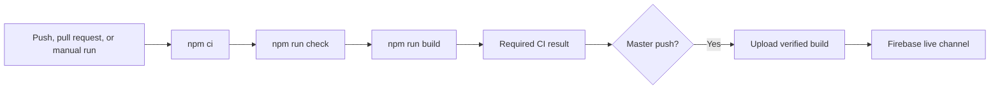

# Continuous Integration

GitHub Actions verifies every pull request targeting `master`, every push to `master`, and every manual run. The CI job uses Node.js `22.22.3`, installs the exact lockfile dependency graph with `npm ci`, runs the repository quality gate through `npm run check`, and then creates the production Angular bundle with `npm run build`. Successful master push runs upload that build and deploy it to the Firebase Hosting live channel. Workflow permissions are read-only. New PR runs cancel older runs for the same ref; master runs are serialized without canceling active deployments. GitHub concurrency may replace older pending runs with newer ones.

```yaml
jobs:
  verify:
    steps:
      - run: npm ci
      - run: npm run check
      - run: npm run build
  deploy:
    needs: verify
    if: github.event_name == 'push' && github.ref == 'refs/heads/master'
    # Downloads the build from verify and deploys with the service-account secret.
```



Invariants:
- `.github/workflows/ci.yml` is the CI source of truth.
- CI targets `master`, the repository's default branch.
- `package-lock.json` controls installed dependency versions.
- `npm run check` must continue to include linting and the complete non-watch unit suite.
- CI must produce a production build after the quality gate passes.
- Production replaces `src/environments/environment.ts` with `environment.prod.ts`, whose API base URL is `https://cinema-catalogue-be.onrender.com/api`. Development uses `http://localhost:4200/api` with the local proxy.
- Workflow permissions remain read-only unless a future job has a documented need to write.
- `.firebaserc` selects project `zwezh-media-shelf`. `firebase.json` targets Hosting site `media-shelf` (`https://media-shelf.web.app`), serves `dist/app/browser`, revalidates cached responses, and rewrites `/` plus extensionless Gallery, Statistics, Settings and About paths to the app shell. New root routes require updating that pattern. Missing assets and `/api` are not rewritten.
- Deployment uses `FIREBASE_SERVICE_ACCOUNT_ZWEZH_MEDIA_SHELF`, a GitHub Actions secret containing a deployment service-account JSON key. The browser Firebase config does not authorize deployments. The account needs Firebase Hosting Admin and API Keys Viewer for this static live deployment.
- PRs and manual workflow runs validate only. Merging a PR triggers deployment through the resulting master push.
- Repository administrators must configure master protection to require `Lint, test, and build`, require branches to be current, and disable bypassing when the gate should apply to admins. These external settings are not enabled by the YAML. The deploy job must not be a required PR check because it runs after merging.
- Production backend CORS must permit the Firebase web.app/firebaseapp.com origins and any custom domain. Backend deployment is separate.

Setup instructions are in [README](../../README.md#firebase-deployment-and-merge-protection). Actual service-account provisioning, GitHub secrets, branch protection and live deployment require account setup outside the repository.

Related lodes: [project practices](../practices.md), [project summary](../summary.md), [PWA hosting](../ui/pwa.md).
