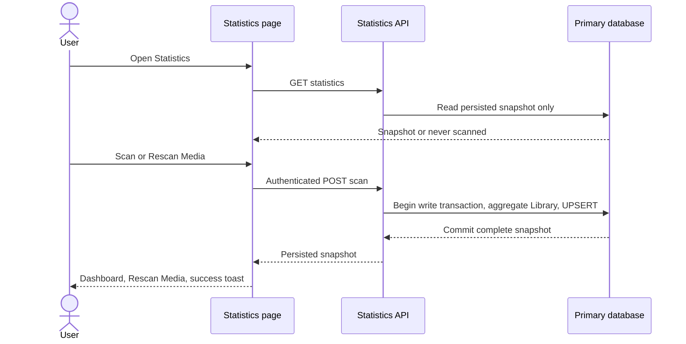

# Persisted Library Statistics

Status: implemented on `feat/persisted-statistics` in both repositories. See [current Statistics contract](../statistics/summary.md) for ownership, verification and rollout. The user approved the live rollout; schema version 9 was applied and BE restarted on 2026-10-10. Live Statistics and existing collection reads passed verification.

Reference: `stitch-statistic/code.html`, `screen.png` and `DESIGN.md` at the workspace root. Use their dashboard layout as inspiration with the current application shell, design tokens and themes. Preserve existing Movies, Series, Wishlist and Gallery behavior.

## Scope and first-use behavior

Statistics cover titles joined to `library_entries` only: Movies and Series. Wishlist-only titles never contribute to any metric. A title with both memberships contributes once through its Library membership. Historical distinct title IDs remain distinct, even when provider IDs match.

- First visit with no saved snapshot: show the Statistics title, one `Scan Media` button on the right, and “Statistics have not been calculated yet. Click Scan Media to calculate your library statistics.” No sample cards, fabricated numbers or charts.
- A successful scan stores the snapshot and displays its dashboard. The button becomes `Rescan Media`, including when the scanned library is empty.
- Subsequent visits load the saved snapshot without aggregating source data. Show “Last scanned” with a localized timestamp. Library changes do not automatically recompute statistics; the timestamp makes the snapshot's age visible.
- While scanning, disable the action and announce progress. During a rescan keep the existing results visible. Success replaces the dashboard and shows a toast; failure retains the old snapshot and shows an error toast. A failed first scan leaves the initial empty state and Scan button.
- Scan is an authenticated mutation, following existing protected-control/login behavior; viewing the persisted snapshot remains public like collection lists. Read failure shows a retry action that retries only snapshot loading.
- Keep only the scan/rescan button in the right action area. Omit date range and export controls, Wishlist KPI, Wishlist segments/legends, storage/file-size metrics and Recent Library Activity.
- “Scan” means aggregate the stored library metadata. It does not scan a filesystem, call Poiskkino, refresh individual titles or read complete collection DTOs.

## Metric definitions

Use honest labels and explicit denominators. Calculate counts in SQL and derive display percentages from those counts. Zero denominators render 0% or an empty chart; missing values never become invented zero ratings/years.

| Dashboard section | Definition |
| --- | --- |
| Total Library KPI | Movies + Series title count; a two-segment Movie/Series composition bar with counts and percentages. |
| Movies KPI | Movie title count; cumulative known movie runtime in minutes, displayed as hours. Include known-runtime coverage because missing runtime is excluded, not estimated. |
| Series KPI | Series title count; recorded season rows (including season zero/specials) and available regular seasons (`is_available=1 AND season_number>0`), with labels/copy explaining that distinction. |
| Genre breakdown | Number of distinct library titles for each stored genre, counted once per title/genre. Denominator is total library titles. A title can have multiple genres, so percentages can total more than 100%. Show top eight ordered by count descending then label, with coverage for titles without genres; store the full aggregate. |
| Quality donut | One mutually exclusive bucket per library title, based on available distinct quality values; details below. Total segments equal total library titles. |
| Release timeline | One representative release year per title, grouped into decades; Movie uses earliest known release year, Series uses `start_year` with earliest known stored year as fallback. Do not expand series across every year or count a multi-year Movie repeatedly. Missing years have a separate Unknown count. |
| Rating distribution | Stored Kinopoisk rating, not personal/watched ratings. Bins `[0,1)` through `[8,9)` and `[9,10]`; null is Unknown and valid zero stays zero. Show known-rating count, mean, exact median and count rated 9+. Use real histogram data rather than a fabricated bell curve. |

The prototype's Total Episodes cannot be calculated from current stored metadata. Omit it. Series `movie_length` is episode duration and must not be treated as total Series runtime. Omit fabricated month-over-month growth, “100% indexed” and hard-coded UHD percentages.

### Quality counting

For Movies, use distinct qualities from `title_formats`. For Series, use distinct qualities from `season_formats` joined to available seasons, including available specials. Unavailable seasons do not imply owned quality; generic Series title formats are not a substitute for available season formats.

A title with exactly one distinct quality goes into that actual catalog quality bucket; two or more go into `Multiple qualities`; none goes into `No available quality`. Duplicate extensions at the same quality do not increase counts. Custom and retired quality values remain visible under their actual labels. Do not guess a “best” quality or normalize free-form settings values into 4K/1080p tiers.

Store bucket discriminants (`quality`, `multiple`, `none`) separately from actual quality values so user-defined quality labels cannot collide with special buckets. This provides a meaningful, non-overlapping title-level donut without counting one Series once per season. An adjacent caption states that the distribution is per title.

## Database design and consistency

A migration is necessary because the user requires durable snapshots. Add the next catalog migration after current schema version 8 and update version/ledger validation, initialization and upgrade tests together.

Use one singleton table, `library_statistics_snapshot`, rather than multiple dimension tables: the dashboard reads and replaces one bounded aggregate document and does not query individual historical snapshots.

```sql
CREATE TABLE library_statistics_snapshot (
  id TEXT PRIMARY KEY CHECK (id = 'library'),
  schema_version INTEGER NOT NULL CHECK (schema_version = 1),
  scanned_at TEXT NOT NULL,
  payload_json TEXT NOT NULL CHECK (json_valid(payload_json))
) STRICT, WITHOUT ROWID;
```

The migration creates an empty table. It must not precompute statistics or insert an empty snapshot. An empty successfully scanned library is distinct from never scanned. `schema_version` is the aggregate contract version, independent of the catalog migration version; future incompatible formats require an explicit migration/recalculation decision.

Persist totals and full genre/quality/decade/rating aggregates, not source title rows, posters, descriptions, formats or entire seasons. Include coverage counts for missing values. Validate decoded stored JSON against the current contract instead of casting it. No foreign keys to live genres/qualities: a snapshot is historical and must survive deletion or renaming of source metadata until a user rescans.

Calculation and replacement use the authoritative primary database, not a potentially lagging read replica. Run set-based aggregate SQL inside one `writeTransaction`: read a consistent Library snapshot, assemble and validate the aggregate, then UPSERT the singleton and commit. Return that exact committed aggregate. Any late failure rolls back replacement and leaves the previous snapshot intact.

Avoid N+1 SQL, per-title API reads, downloading full metadata into JS, and long provider/network operations inside this transaction. Deduplicate title/genre and title/quality relations before counting so joins do not multiply titles, seasons or runtimes. Use current membership, title-kind, genre, season and format indexes; add indexes only after measuring query plans on realistic fixtures.

Measured fixture query plans justified a `titles_statistics(kind,movie_length,rating,year_json,id)` covering index in version 9. The aggregate queries use this compact index to avoid retrieving large title descriptions/posters.

Concurrent scans serialize through the primary write transaction across backend instances. A later committed scan replaces the earlier snapshot as a whole; readers see either complete snapshot. Retain existing bounded whole-transaction SQLITE_BUSY retry rules. The frontend prevents duplicate local submissions; an in-memory mutex alone is not the consistency mechanism.

GET reads the one snapshot row from the primary for read-after-scan correctness. This is a small read, not a catalog scan. Do not call the catalog write wrapper that triggers a complete replica sync merely for storing a statistics snapshot. Preserve the existing isolation of native replica sync from the HTTP event loop.

Measure scan time, SQL statement count and response size. If a production-scale scan exceeds the acceptable synchronous request budget, design a persisted scan job before release; do not introduce polling, a queue or progress tables without evidence. Existing catalog requests must remain responsive during scanning; measure contention as well as scan time.

## Backend contract and ownership

Add `modules/statistics/` with one controller, focused service and exported response types; persistence and SQL live in `database/statistics/statistics.repository.ts`. Use Nest constructor injection, the current libSQL transaction helpers, and node:test/Supertest. Keep the installed persistence/testing stack.

| Endpoint | Behavior |
| --- | --- |
| `GET /api/statistics` | Public. Read saved singleton only; 200 `{ snapshot: null }` before first scan, otherwise `{ snapshot: StatisticsSnapshot }`. No source aggregation and no creation as a read side effect. |
| `POST /api/statistics/scan` | JWT protected. No filter/date-range payload. Aggregate Movies/Series Library only, atomically replace persisted snapshot, return 200 `{ snapshot: StatisticsSnapshot }` after commit. Validate unexpected request inputs consistently. |

`StatisticsSnapshot` contains contract version, UTC scanned timestamp, totals/coverage and compact aggregate arrays. Counts are nonnegative integers, rates stay within supported bounds, totals and bucket sums obey metric definitions, and the never-scanned sentinel is explicit. Report failures using existing sanitized HTTP error conventions without exposing SQL or credentials.

Do not change collection CRUD responses, Gallery summaries, wishlist transfer policies or title autofill contracts. No automatic scan in collection save/delete handlers or database startup.

## Media-shelf business logic before page implementation

Create an independent Statistics read/mutation slice under `features/statistics/`:

```text
models/statistics-snapshot.ts
application/statistics.repository.ts
application/get-statistics.query.ts
application/scan-statistics.use-case.ts
infrastructure/http-statistics.repository.ts
infrastructure/statistics-parser.ts
state/statistics.store.ts
utils/statistics-display.ts
pages/statistics.ts + statistics.html + statistics.scss
components/statistic-card.ts
components/statistics-chart-panel.ts
```

Repository operations are `getSnapshot()` and `scan()`, with validated `unknown` HTTP responses and existing AppError mapping. Bind the repository once at app composition. Pages never import transport DTOs or HttpClient; application operations do not depend on Router, translations or toasts.

A page-provided SignalStore owns a single request-state model and the current snapshot: initial load, ready/unscanned, ready/scanned, scanning and read error. Snapshot presence determines Scan versus Rescan; numeric totals do not. Keep stale results on rescan failure. Mutation response replaces state directly; do not add a follow-up GET, entity cache or a second resource owner.

Use the established Observable query/use-case and SignalStore boundaries for consistency and cancellation, with no interval polling. The Lode preference for `httpResource` does not justify a parallel transport state owner; any resource adaptation must remain behind the repository boundary. Navigating away releases page subscriptions; a backend scan already committed stays persisted.

Prepare parser/repository/store behavior tests before replacing the placeholder. Use strict TypeScript, `unknown` at transport boundaries, `inject()`, explicit OnPush, signals/computed, standalone defaults and native template control flow as required by the user.

## Dashboard implementation after business-logic gate

Keep the existing lazy `/statistics` route and application header/footer/global search. Adapt the Stitch main canvas into a three-card KPI row and two responsive chart rows: genre + quality, release decades + ratings. On narrow screens stack panels and prevent overflow; use both theme palettes and existing semantic tokens, not copied Tailwind/CDN assets or hard-coded prototype data.

Reuse existing buttons, Icon, EmptyState, PageStatus, RequiresAuth, toast feedback and typography/surface/card design tokens. Existing MediaCard is a poster/entity card, so create a small focused Statistics KPI card only where existing card composition is unsuitable. Keep chart-panel framing reusable within Statistics; promote it to shared UI only when another feature genuinely consumes it.

Use native SVG/CSS for the donut and histograms plus native genre progress visuals; no chart dependency is required for these small static distributions. Pair charts with readable text legends and an accessible data table/list. Charts cannot rely only on color or hover; use labels/counts, sufficient contrast, keyboard-operable controls and reduced-motion support. Avoid clipping SVG text at small widths and duplicated screen-reader data.

Localize all labels, empty/progress/error states, percentages, numbers and scanned timestamps in synchronized English, Polish and Russian resources. The right toolbar has only Scan/Rescan, with progress announced through an appropriate status region. First load/read error, never scanned and successfully scanned empty library remain distinct states.

## Execution order and acceptance gates

1. Finalize the above metrics/DTO and fixtures. Keep the prototype reference and exclusions in this plan.
2. Implement isolated migration + primary SQL aggregation + transactional snapshot persistence; verify rollback, migration idempotency and query plans. Do not apply a live migration as part of planning.
3. Implement Statistics module/endpoints and test authentication, never-scanned sentinel, persisted reads and aggregate semantics. Complete BE typecheck, lint, build and tests.
4. Implement Statistics repository/parser/query/use case/store in media-shelf; verify request ownership, state transitions, retained snapshots and no polling. This completes the business-logic gate.
5. Replace the placeholder with the adapted responsive dashboard, Scan/Rescan controls and i18n, reusing existing UI conventions.
6. Verify runtime performance, accessibility and existing-page compatibility; update current Statistics Lodes, routing summary and map when implementation changes reality.

Backend fixtures cover: Wishlist-only exclusion; dual membership once; separate historical IDs; Movies-only/Series-only/mixed/empty libraries; null and zero values; multiple years; specials and unavailable seasons; multiple formats/extensions; retired/custom quality values; duplicate genres; deterministic ordering; exact rating median; failed first scan; failed rescan retains the old snapshot; repeated and concurrent scans; migration upgrade/idempotency; GET performs only snapshot reads even after library mutations.

Frontend/browser acceptance covers: first-use guidance and Scan label; zero-count snapshot uses Rescan; reload reads persisted results; one POST per click; retained data on failure; success/error toasts; authenticated controls; read retry does not scan; both themes at 320px/desktop; AXE/WCAG AA, focus and keyboard access; SVG/text data parity; no storage/Wishlist/activity/date/export/episode placeholders. Existing collection and Gallery actions, routes and visuals remain unchanged.



Related Lodes: [business architecture](../gallery/business-logic-architecture.md), [Series/Wishlist](../gallery/series-wishlist.md), [UI tokens](../ui/design-tokens.md), [style primitives](../ui/style-primitives.md), [routing](../routing/summary.md), [auth](../auth/summary.md), [toasts](../ui/toast-notifications.md), [practices](../practices.md), [minimal change](../minimal-change.md).
