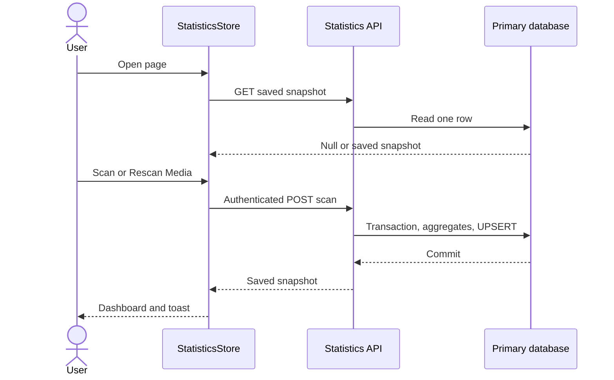

# Persisted Library Statistics

The public lazy `/statistics` page reads a saved snapshot. Only the authenticated Scan Media action calculates it; opening/reloading the page never scans or polls. Movies and Series with Library membership contribute once; Wishlist-only items are excluded. Existing Gallery and collection pages remain unchanged.

## Ownership and API

`models/statistics-snapshot.ts` defines the feature model. `StatisticsRepository` is the application token bound to `HttpStatisticsRepository` in app composition. `GetStatisticsQuery` and `ScanStatisticsUseCase` expose focused Observable operations. The HTTP repository validates unknown responses with `statistics-parser.ts` and maps failures to AppError; there is no redundant forwarding API client.

```typescript
getSnapshot(): Observable<StatisticsSnapshot | null>;
scan(): Observable<StatisticsSnapshot>;
// GET /api/statistics -> { snapshot: null | StatisticsSnapshot }
// POST /api/statistics/scan, body {} -> { snapshot: StatisticsSnapshot }
```

`StatisticsStore` is page-provided and owns `loading | ready | scanning | error` plus a nullable snapshot. Initial load and read retry use one query. Scan is guarded against duplicate clicks, replaces state directly from its response, and shows a success/error toast. Rescan keeps previous results visible and preserves them on failure. Page destruction cancels subscriptions and suppresses mutation feedback. No global cache, follow-up GET or interval is used.

A null snapshot means never scanned; a zero-title snapshot means successfully scanned empty. These states determine Scan versus Rescan independently of numeric totals. Read errors expose a retry that never starts a scan. Guests can read saved results but see a disabled scan control and sign-in guidance.

## Persistence and metrics

Backend schema version 9 creates the singleton `library_statistics_snapshot` table and a compact `titles_statistics` covering index. GET reads only the primary snapshot row. Scan runs six SQL aggregates and a snapshot UPSERT in one primary write transaction, serializing concurrent scans. Failure rolls back; catalog changes leave the snapshot unchanged until explicit rescan. No catalog replica synchronization or provider request is needed.

The saved version-1 payload contains UTC `scannedAt`, totals, full genre/quality/decade aggregates, unknown counts and rating bins/mean/median. Runtime parsers validate the discriminator, timestamp, finite numbers, unique buckets and cross-field totals on both boundaries.

- Three KPI cards: total titles, Movies, Series. Movie runtime includes known runtimes only, displayed in hours with coverage. Recorded seasons include specials; available season count includes regular seasons only.
- Genres count distinct titles per genre; percentages use total Library titles and can exceed 100% together. Show top eight with an expandable full list and unknown-genre coverage.
- Quality assigns exactly one bucket per title: one distinct quality, multiple qualities, or no available quality. Duplicate extensions do not add counts. Series use available seasons, including specials; unavailable season formats are excluded.
- Release decade uses the earliest stored Movie year, or Series start year with earliest-year fallback. Missing years remain unknown.
- Ratings use valid values 0–10, ten bins (last includes 10), exact mean/median, unknown count and the 9+ count. Null is not zero.

No Wishlist KPI, file sizes, episode estimates, recent activity, date filters or export are rendered.

## Presentation and verification

KPI cards and scan/rescan controls render immediately; chart panels use independent viewport-triggered @defer with localized feedback and reserved placeholders. Deferral never initiates a scan or another snapshot read. See [frontend performance](../ui/performance.md).

The page adapts `stitch-statistic/code.html` into a three-card KPI row and four chart panels. Focused feature components frame KPI/chart content; shared Icon, EmptyState, PageStatus, RequiresAuth, buttons and toasts are reused. Charts use native SVG/CSS and complete readable legends/counts; SVG is decorative. Semantic theme tokens support light/dark, layouts stack at narrow widths, and EN/PL/RU resources localize labels, dates, numbers and percentages.

Verification: FE full suite (342 tests) plus a targeted first-scan failure regression, strict spec compilation, lint/format and production build; BE fixture and HTTP tests cover authentication, migration, aggregation, persisted reads, corruption, concurrency and rollback. Browser flows verify scan/reload/error/guest/empty behavior and ten AXE audits across themes, 320px/desktop and localized PL/RU layouts. Existing bundle budget warnings remain unchanged. An isolated 10,000-title fixture scanned in approximately 0.7 seconds after the covering-index optimization; production/network timing can differ.

Database tests use isolated fixtures. The user approved the live schema version 9 migration and backend restart on 2026-10-10. Live GET and frontend proxy return the never-scanned sentinel; unauthenticated scan returns 401 and Gallery/Movie/Series/Wishlist reads remain healthy. The first scan is left to the page action. Future deployments require migration and restart on their approved target database; source changes alone do not authorize a live migration.



Related Lodes: [implementation plan](../plans/statistics.md), [business architecture](../gallery/business-logic-architecture.md), [routing](../routing/summary.md), [auth](../auth/summary.md), [tokens](../ui/design-tokens.md), [toasts](../ui/toast-notifications.md).
