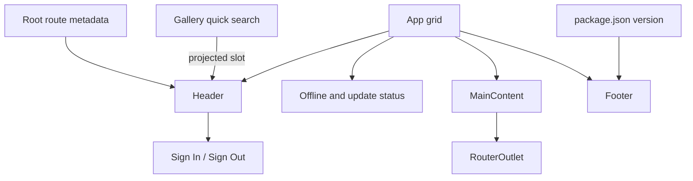
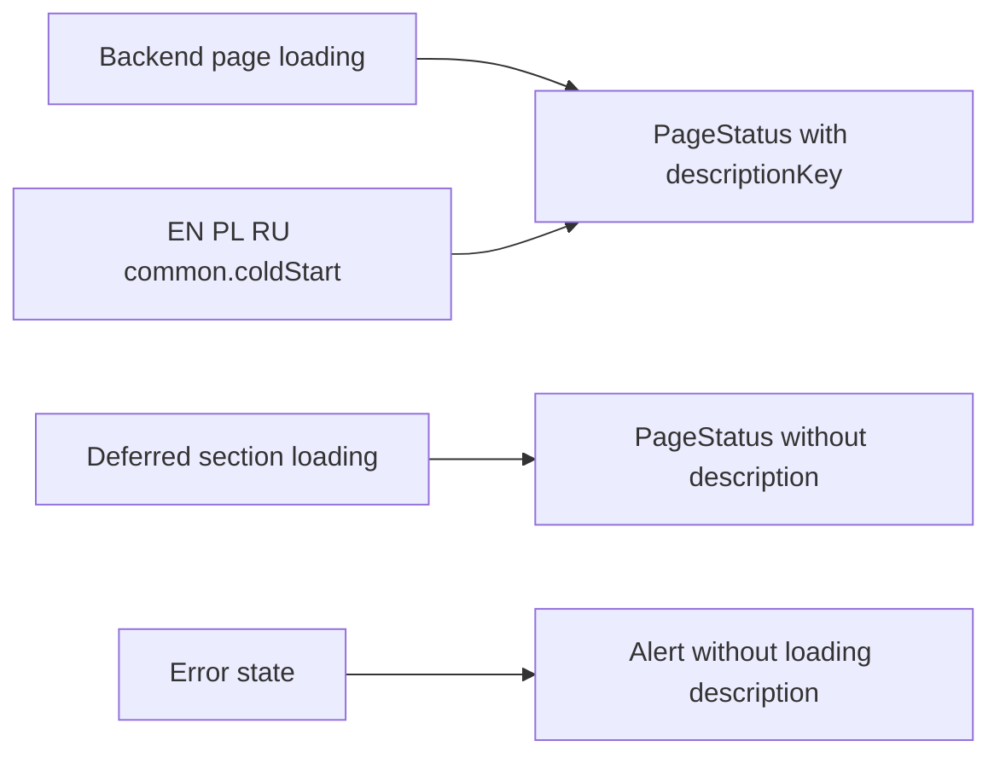

# Application Shell

The root `App` composes standalone layout components: `Header`, `PwaStatus`, `MainContent`, and `Footer`. The host is a row grid with `auto auto minmax(0, 1fr) auto`, so short feature pages keep the footer at the viewport bottom while long pages expand normally. `MainContent` owns the application's only semantic `<main>` and primary `RouterOutlet`; routed feature pages use sections and own their internal grids and padding.

```html
<msh-header [navigationItems]="navigationItems">
  <msh-quick-search header-search />
</msh-header>
<msh-pwa-status />
<msh-main-content />
<msh-footer [version]="version" />
```

```scss
.main-content {
  display: grid;
  align-content: start;
  min-height: 100%;
}
```



Contracts:

- The desktop header is 56 px high with 24 px inline padding; at 48 rem and below it is 64 px high with 16 px padding.
- The application header is sticky at the viewport top and remains above feature-level sticky navigation.
- At 640 px and below, root navigation is hidden behind a header hamburger button. `NavigationPanel` opens through `FloatingPanel` with `start` placement: a full-height left drawer slides from left to right, with the MediaShelf logo and name above root navigation links. It has a translated dialog label and close button, safe-area padding and internal overflow scrolling, and closes on link selection, route navigation, Escape or backdrop dismissal. Focus returns to the trigger on dismissal. Reduced-motion preferences disable the slide animation.
- Only Gallery routes render the fixed mobile bottom bar, owned by `GalleryLayout`: All items, Movies, Series and Wishlist. The bar is 64 px tall before the bottom safe area, with a 90% shell-surface tint and backdrop blur. Root padding and toast clearance apply only while Gallery is present. Desktop Gallery subnavigation remains below the header. Authentication controls become icon-only visually while retaining their translated accessible text.
- Gallery's mobile Movies, Series and Wishlist links use the supplied clapperboard, TV/play and bookmark SVGs at `public/icons/{movies,series,wishlist}.svg`, loaded through the typed `IconRegistry`. Their `currentColor` follows the link state; icons are decorative and link labels remain accessible. The All items icon remains `gallery`.
- The header renders Sign In for an empty session and Sign Out for an authenticated session restored from storage when valid. Sign In dynamically imports the authorization dialog, disables its trigger while loading and reports load failures; Sign Out clears both signal and persisted token state and reports success through the global toast viewport.
- The header receives root navigation items from `App`; it does not import route configuration.
- The header exposes a `[header-search]` projection slot. `App` fills it with the Gallery-owned debounced quick search, preserving the rule that layout never imports feature logic.
- At 640 px and below, a search icon opens the projected search over the header controls. The close button or Escape hides it and restores trigger focus after rendering; opening focuses the input. Desktop keeps the inline field.
- `Gallery` remains active for `/gallery` child URLs such as `/gallery/wishlist`.
- The main content shell is full width and adds no feature padding.
- Routed components are aligned to the top of the main content shell; empty and short feature pages leave unused space below their content.
- The footer displays the product description, `Library Synced`, and the `package.json` version through `APP_VERSION`.
- Nunito Sans weights 400, 600, 700, and 800 are bundled locally through `@fontsource/nunito-sans`.
- Shell components use `--color-shell-*` and `--size-shell-*` tokens rather than hard-coded layout values.

Related lodes: [authentication](../auth/summary.md), [UI summary](summary.md), [design tokens](design-tokens.md), [quick search](quick-search.md), [routing](../routing/summary.md).

## Backend loading copy

`PageStatus` accepts an optional `descriptionKey`. Backend page loading states (Gallery, Movies, Series, Wishlist, details/editors, Settings and Statistics) pass `common.coldStart`. The translated description explains Render free-plan sleep and a first request of roughly 30–60 seconds, sometimes longer, after inactivity. It is explanatory copy, not a timeout, delay or server-status measurement. Error states suppress the description; deferred JavaScript sections omit it because they do not wait for Render. The spinner remains decorative, the loading status uses polite announcements, and reduced motion stops rotation. About and README explain the same hosting behavior.

```html
<msh-page-status messageKey="movies.loading" descriptionKey="common.coldStart" />
```



The production shell is installable and caches static resources for offline reopening. Header, footer and body respect device safe-area insets. Installation and update behavior is documented in [PWA](pwa.md).
