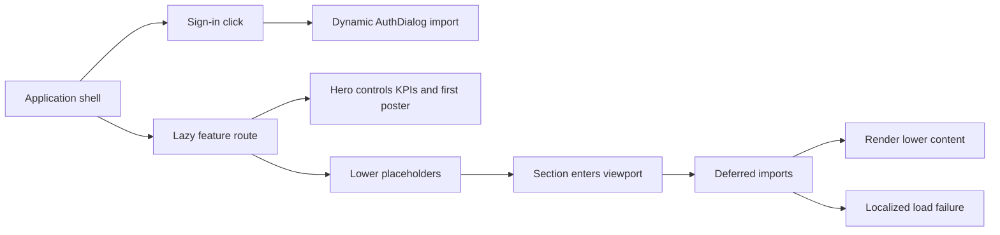

# Frontend Loading and Rendering

MediaShelf uses Angular 22 standalone components, zoneless change detection, signals/computed projections and lazy feature routes. Performance changes preserve URL-owned state, authentication, accessible controls and the PWA offline contract.

## Loading boundaries

| Area | Contract |
| --- | --- |
| Shell | Header, search, navigation, status notices and outlet render immediately. |
| Sign in | AuthDialog imports on demand; the trigger is busy/disabled during loading. Concurrent clicks and destroyed owners cannot open another dialog; failures show localized feedback. |
| Gallery and collection lists | Cards render immediately. The first poster is eager with high priority; others load lazily. Images decode asynchronously; compact URLs remain preferred where available. |
| Details | Hero, breadcrumbs and mutation controls are eager. Production/cast, technical information, related titles and Series season tables defer until the lower wrapper enters the viewport. |
| Statistics | Snapshot loading, scan/rescan and KPIs are eager. Four chart panels have independent viewport-triggered defer blocks; triggers never repeat a snapshot read or scan. |
| About | Static screenshots already use NgOptimizedImage, explicit dimensions and lazy loading. History and dependency copy remain available without another deferred component. |
| Editors/settings | Forms, validation and save controls remain immediate. Remote artwork previews load lazily and decode asynchronously. |
| Quick search | Existing 300 ms debounce, cancellation and six-result bound remain. Preview posters load lazily and decode asynchronously. |

```html
<div #detailContent class="movie-details__content">
  @defer (on viewport(detailContent)) {
    <msh-production-and-cast [movie]="movie" />
  } @placeholder {
    <msh-page-status messageKey="deferred.loading" />
  } @error {
    <msh-page-status kind="error" messageKey="deferred.error" />
  }
</div>
```

Placeholders reserve a minimum of 20rem in lower details and charts to reduce layout jumps. Feedback is localized in EN/PL/RU with status/alert semantics. Essential controls and likely above-the-fold content stay eager. Avoid idle prefetch for viewport sections without a concrete reason.



## Audit findings and limits

- Root and feature routes already use loadChildren/loadComponent. Deferral controls rendering, not API caching or data-fetch policy.
- Search/list reads already use switchMap cancellation. Settings shares one root httpResource with computed catalogs. Ordinary lists have bounded 30-card pagination; virtual scrolling is unnecessary for that size.
- Icons share a cached loader promise per name; fonts are local. Static images use NgOptimizedImage; remote posters retain native fallback handling.
- The worker prefetches all JavaScript, including deferred chunks, to preserve offline reopening of unvisited routes. Deferral reduces initial execution/rendering but does not eliminate later PWA cache downloads.
- AuthSession.restore() runs in the background; bootstrap and public routes do not await backend authentication. Auth requests have a 15-second timeout, with any cross-tab Web Lock wait occurring before that timer. Protected route guards await the shared startup restoration before deciding access.
- About history screenshots use quality-90 WebP at their original dimensions, totaling roughly 618 kB. They are lazy and cached only after use; full-size links and README share the optimized files.
- Initial bundle and Header/QuickSearch/MediaCard style budgets remain exceeded. Do not raise budgets merely to suppress warnings.
- Build statistics establish chunk boundaries and byte sizes, not mobile CPU, LCP, INP, CLS or live network timing. Real-device/Lighthouse and browser AXE verification require an available browser.

Related lodes: [shell](application-shell.md), [PWA](pwa.md), [media gallery](media-gallery.md), [quick search](quick-search.md), [statistics](../statistics/summary.md), [About](../about/summary.md), [authentication](../auth/summary.md).
