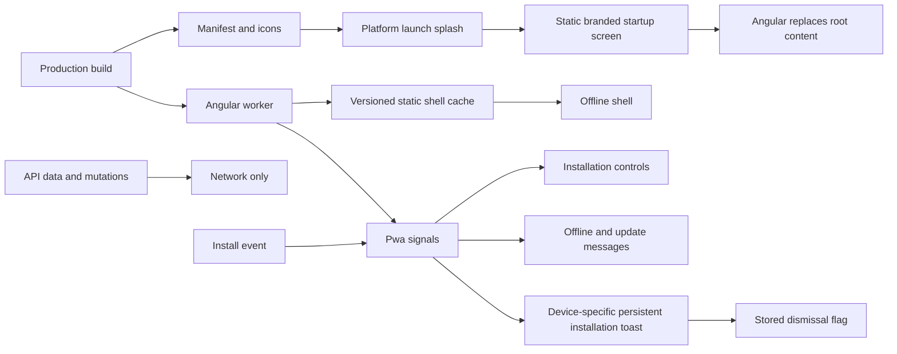

# Mobile Installation and Offline Shell

MediaShelf is an installable standalone PWA. Production builds use the official Angular service worker; development builds do not register one. About exposes installation only on Android and iOS/iPadOS devices, independently of authentication and backend availability.

## Contracts

- `public/manifest.webmanifest` uses a stable root ID/scope and launches `/gallery` in standalone mode. Shortcuts open Movies, Series and Wishlist. PNG icons derive from `public/logo.svg`; the maskable variant has padding around the mark. The Apple touch icon is opaque.
- The manifest's `background_color` matches the light shell (`#faf8ff`). Android browsers generate their native launch splash from the manifest name, icons and background; native splash presentation remains platform-owned.
- `src/index.html` places a centered decorative `logo.svg` and MediaShelf name inside `msh-root` while JavaScript and application initializers load. Critical styles are inline so the screen appears before bundled CSS; fallback colors/font work before design tokens load. The busy main landmark has an accessible loading label. Angular replaces this content on the first root render, with no timer or minimum delay. This startup screen also appears in browser tabs and after the platform launch splash in installed apps; it is not an iOS native launch image. Its image is plain HTML because Angular directives, including `NgOptimizedImage`, cannot run before bootstrap. The existing worker cache includes index.html and logo.svg.
- `viewport-fit=cover`, shell safe-area insets and the existing `100dvh` sizing support device cutouts and home indicators.
- `ngsw-config.json` prefetches the app shell, all lazy JavaScript, CSS/fonts, UI icons, poster placeholder and all three language dictionaries. A completed first online visit is required for offline reopening. Deferred chunks are still prefetched by the worker; @defer postpones application execution/rendering rather than excluding chunks from the offline cache. See [performance](performance.md).
- History screenshots use a separate lazy asset cache: they are stored only after viewing, without enlarging the initial shell download. API responses, auth, settings, catalog records and remote posters are not cached. There are no data groups or offline mutation queues. API paths are excluded from navigation fallback. Offline pages show the existing data-loading errors and a connection notice.
- `core/pwa/Pwa` owns install-event capture, installed/connection signals and worker updates. Root `PwaStatus` starts it before About opens.
- Install prompts run only after clicking Install app. The prompt is consumed once, dismissal is respected, failures have a status message, and `appinstalled` confirms completion. iOS standalone detection also uses `navigator.standalone`.
- `Pwa.mobilePlatform` detects Android and iPhone/iPad/iPod user agents, including touch-capable iPads presenting as MacIntel; desktop browsers return null.
- On the first mobile shell render, `PwaStatus` shows a closable info toast with the detected platform's translated, optional installation guidance (“If you'd like to use MediaShelf as an app…”), `autoHide: false`, and no timeout. Installed apps and browsers with `StorageKey.PwaInstallationDismissed === 'true'` skip it. Closing stores that flag through guarded `BrowserStorage`; blocked storage remains best-effort.
- About's installation component is hidden entirely on desktops, including its layout spacing.
- Browsers without a prompt get manual iOS/Android instructions via a native disclosure. Instructions remain available without server settings or sign-in.
- `VERSION_READY` and unrecoverable worker states expose a Reload app button with a save-work reminder. Reload is never automatic and does not call `activateUpdate()`. Returning to a visible online app checks for updates; failures preserve the current version. Listeners/subscriptions are cleaned up.
- Connectivity is a browser network hint; it does not claim that the API is reachable.

```typescript
provideServiceWorker('ngsw-worker.js', {
  enabled: environment.production,
  registrationStrategy: 'registerWhenStable:30000',
});
```



## Hosting and verification

Deploy `dist/app/browser` atomically to an HTTPS origin. Localhost is the development exception; HTTP on a phone's LAN address does not support service workers. Route rewrites must serve index.html for application routes, never for API requests or missing worker/manifest/assets. Keep old hashed assets available during upgrades and serve `index.html`, `ngsw.json`, `ngsw-worker.js` and the web manifest with revalidation rather than an immutable cache. Hashed bundles can be immutable.

Verify the production build, not the normal development server. Load once online, wait for shell precaching, reopen with the static server unavailable, and check About plus another lazy route. Actual home-screen installation must also be checked on Safari/iOS and Chrome/Android; desktop emulation does not establish platform installation behavior.

Related lodes: [application shell](application-shell.md), [About](../about/summary.md), [internationalization](../i18n/summary.md), [minimal change](../minimal-change.md).
